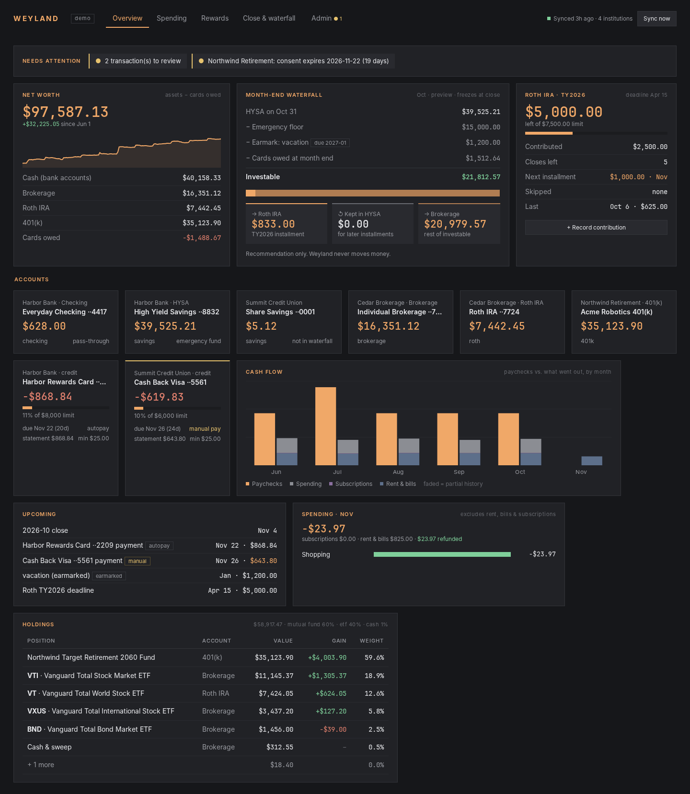
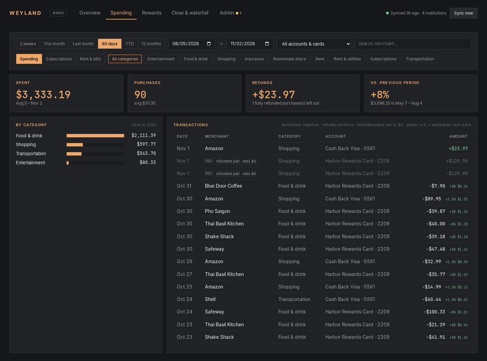
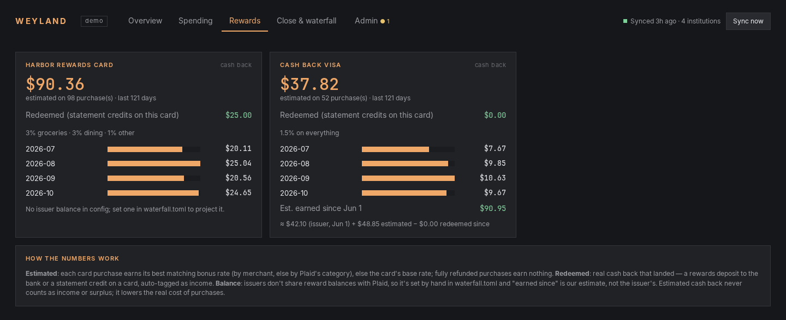
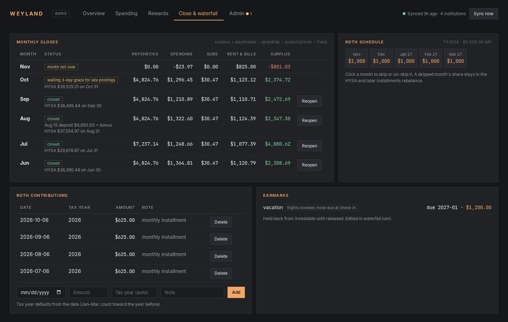
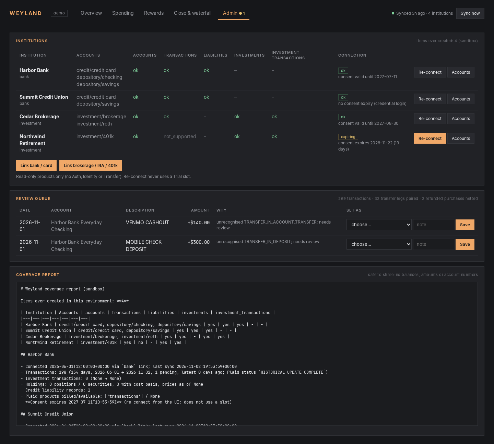

# Weyland

Read-only personal finance dashboard: Plaid aggregation, a monthly close, and a
waterfall allocation planner. Weyland syncs your accounts, classifies every
transaction (transfers, refunds, paychecks, spending), closes each month with
verifiable figures, and recommends where surplus money should go — high-yield
savings floor first, then IRA installments within IRS limits, then a taxable
brokerage. It never moves money; every recommendation is yours to execute.

Single-user by design, US-centric (Roth IRA / IRS annual limits), self-hosted
on your own box. Your data never leaves it — no third-party analytics, no CDN
JavaScript, no accounts on anyone else's server.

## What it does

- **Plaid sync** — transactions, balances, holdings, and investment
  transactions, on a twice-daily systemd timer. One SQLite DB per Plaid
  environment, so sandbox data can never mix with real data.
- **Classification** — transfer/refund pairing over your full history (not
  just the current month), paycheck detection by cadence, configurable
  category regexes, and a review queue for anything odd, with per-transaction
  overrides pin-able from the UI or CLI.
- **Monthly close** — surplus = paychecks − outflows. A month won't close
  until it should: grace period elapsed, full institution history, no review
  items, HYSA and card balances reconciled against replayed history. Figures
  are frozen at close, and later reclassifications are reported as drift.
- **Waterfall** — investable = HYSA balance − your floor − open earmarks −
  card balances owed. Roth installments are split so they never sum past the
  IRS annual limit, with skip months and bonus routing. Each month's
  recommendation is frozen into the close.
- **Rewards** — per-card cash-back estimation (base rate plus bonus tiers by
  merchant regex or Plaid category detail), redemption tracking, and
  hand-entered issuer reward balances.
- **UI** — one page, tabs (Overview / Spending / Rewards / Close & waterfall /
  Admin), hand-drawn SVG charts, zero client-side libraries.

## Screenshots

All from the built-in [demo](#try-the-demo): a made-up person at made-up
institutions. No real data.



<details>
<summary>Spending, Rewards, Close &amp; waterfall, Admin</summary>









</details>

## Try the demo

No Plaid account, no config, no root:

```console
$ git clone https://github.com/Salochi/Weyland.git && cd Weyland
$ uv run weyland demo        # → http://127.0.0.1:8731/
```

The demo generates about five months of history for a fictional person,
dated relative to today, and serves the real UI on it. Clicking around works:
review transactions, skip a Roth installment, and close last month (once it's
past the 3-day grace period, the same rule real data follows). Each start
rebuilds the data in a fresh temp dir, so nothing you change sticks.
Connecting or syncing banks is disabled, and the demo makes no network calls.
Pass `--host 0.0.0.0` to show it to someone else on your network. It has no
login, which is fine for fake data and is the reason it never reads your real
config or database.

## Requirements

- A Linux box with systemd (any Ubuntu-ish VM, CT, or small VPS works)
- [Tailscale](https://tailscale.com) for access (recommended — auth comes free
  with it), or localhost + an SSH tunnel
- A free [Plaid](https://plaid.com) developer account

## Plaid setup

1. Create a Plaid account at [dashboard.plaid.com](https://dashboard.plaid.com).
   You get **sandbox** keys immediately — use them first.
2. Weyland requests only the **Transactions, Investments, and Liabilities**
   products (Balance is implicit). Never Auth, Identity, or Transfer.
3. When you're ready to connect real banks, apply for the free **Trial plan**
   at `dashboard.plaid.com/trial-plan` (a separate application). Production
   keys appear under Developers → Keys after approval; OAuth banks can take
   another 6–24 hours.
4. The Trial allows **10 Items, ever** — removing an Item does not free its
   slot. Weyland refuses new production links at 8 so you always have room to
   re-link an institution that breaks. Connect real institutions one at a
   time and check the coverage report between each.
5. Do **not** click "Get production access" / the production onboarding tasks
   — that is the paid, one-way plan application, and a personal dashboard
   doesn't need it.

## Install

From a clone, as root on the target box:

```console
$ git clone https://github.com/Salochi/Weyland.git
$ cd Weyland
$ sudo deploy/install.sh <your-tailnet-login>
```

This creates a `weyland` system user, installs to `/opt/weyland` with its own
uv-managed virtualenv, writes the systemd units (`weyland-web.service`,
`weyland-sync.timer`), and enables both. Re-run the same command to upgrade.

Until keys exist, the web service runs in an **unconfigured** state on
purpose: `/healthz` says exactly what's missing, the page shows the setup
steps, and every `/api` route returns 503. Once you've added keys and your
`waterfall.toml`, `sudo systemctl restart weyland-web`.

Then put your Plaid keys in `/etc/weyland/plaid.env`:

```console
PLAID_CLIENT_ID=...
PLAID_SECRET_SANDBOX=...
# later, after Trial approval:
PLAID_SECRET_PRODUCTION=...
```

and validate everything without creating any Items:

```console
$ sudo -u weyland /opt/weyland/.venv/bin/weyland check
```

## Configure

Everything lives in `/etc/weyland` (mode 0640, `root:weyland`):

- `weyland.env` — non-secret knobs (`WEYLAND_PLAID_ENV=sandbox|production`,
  `WEYLAND_DATA_DIR`, `WEYLAND_ALLOWED_USERS`, `WEYLAND_DAYS_REQUESTED`).
  `WEYLAND_ALLOWED_USERS` is the comma-separated list of tailnet logins
  allowed into the UI.
- `plaid.env` — your Plaid keys. Only you edit this.
- `waterfall.toml` — your personal model: account roles, regex rules, HYSA
  floor, earmarks, categories, card limits, reward rates, IRS limits. Start
  from `deploy/waterfall.toml.example` and use institution/account names
  exactly as Plaid reports them.
- `token.key` — created at install; encrypts Plaid access tokens at rest.

`waterfall.toml` is re-read on every request — config changes take effect
immediately, with no restart. Keep it mode 0640 `root:weyland`: if the
service user loses read access the API 500s even though the file parses.

## Run

The app binds to `127.0.0.1:8730` and nothing else. Expose it on your tailnet:

```console
$ sudo tailscale serve --bg 8730
```

Tailscale authenticates the request and injects your tailnet login, which
Weyland checks against `WEYLAND_ALLOWED_USERS`. No Tailscale? Keep it
localhost and use an SSH tunnel — do not put it behind an ordinary reverse
proxy that forwards arbitrary client headers.

Check `systemctl status weyland-web` and `curl -s localhost:8730/healthz`
(locally) or the tailnet URL from another machine.

## Connect institutions

Open the Admin tab and use Plaid Link, one institution at a time; run a sync
after each and read the coverage report (`weyland report`) before the next.
The first sync of a new Item returns partial data (`INITIAL_UPDATE_COMPLETE`);
history fills in over the following syncs (`HISTORICAL_UPDATE_COMPLETE`).

If an institution's login breaks, use its **Re-connect** button (update-mode
Link) — linking the institution again as *new* creates a duplicate Item and
Weyland will refuse it (409).

To try everything without touching a real bank: set
`WEYLAND_PLAID_ENV=sandbox`, then

```console
$ sudo -u weyland /opt/weyland/.venv/bin/weyland sandbox-item
```

creates a sandbox Item with generated transactions. Switching to
`WEYLAND_PLAID_ENV=production` moves to the production DB — sandbox and real
data never share a file — then restart `weyland-web`.

## CLI

`weyland <command>` (as the `weyland` user, `/opt/weyland/.venv/bin/weyland`).
A global `--env sandbox|production` flag overrides `WEYLAND_PLAID_ENV` per
invocation.

| command | purpose |
|---|---|
| `init-key` | create the token encryption key if missing |
| `check` | validate config and Plaid credentials (no Items created) |
| `sync` | sync every connected Item |
| `report [--json]` | print the coverage report |
| `classify [--month YYYY-MM]` | classify transactions; counts + review queue, no amounts |
| `override <id> <class> [--category label]` | pin a transaction's class (e.g. `other_income`, `spending`); `clear` removes it |
| `sandbox-item <kind>` | create a sandbox Item without Link (sandbox only; kinds such as `bank`, `investment` — see `--help`) |
| `demo [--host H] [--port P] [--dir D]` | serve the UI on made-up data; needs no config or keys (see [Try the demo](#try-the-demo)) |

## Troubleshooting

- **A fresh charge shows up nowhere** — pending transactions are skipped;
  it appears once it posts.
- **An investment balance looks stale** — Plaid refreshes investment accounts
  roughly once daily on its own schedule; give it a few syncs.
- **Month won't close** — the close blockers are deliberate (grace period,
  partial history, review items, balance mismatch, undecided bonus). Fix the
  cause; don't force it.
- **500s across the API after a config edit** — `waterfall.toml` permissions;
  see Configure.

## License

[MIT](LICENSE). Weyland is named for Weyland the smith of Germanic legend.
